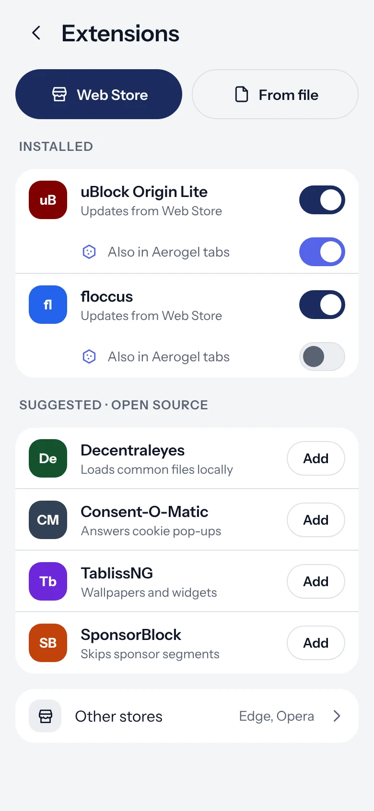
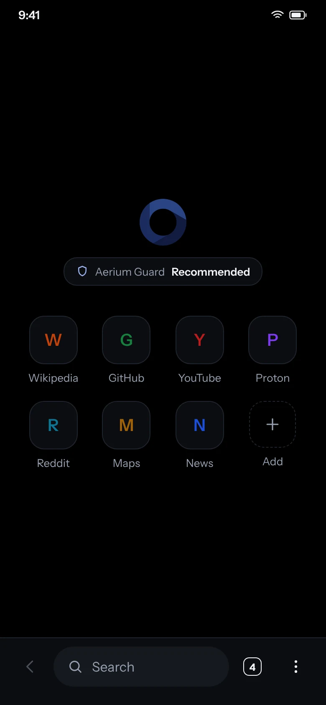
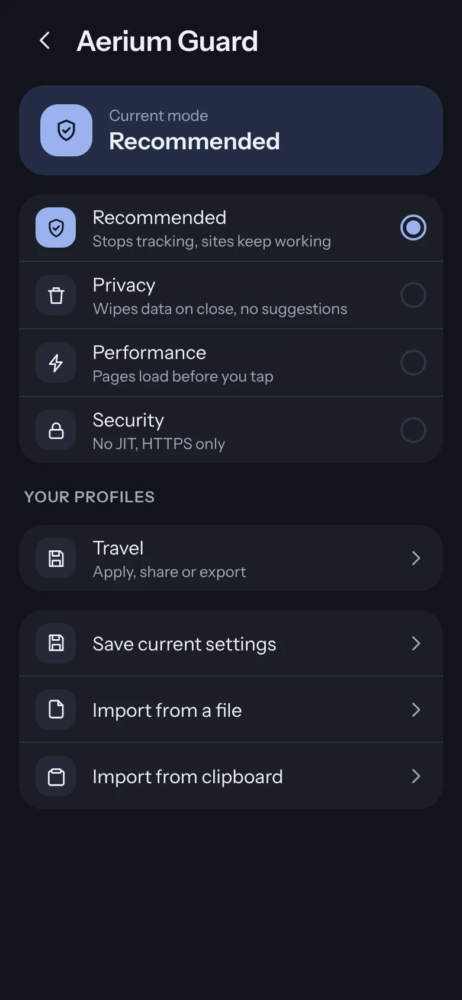
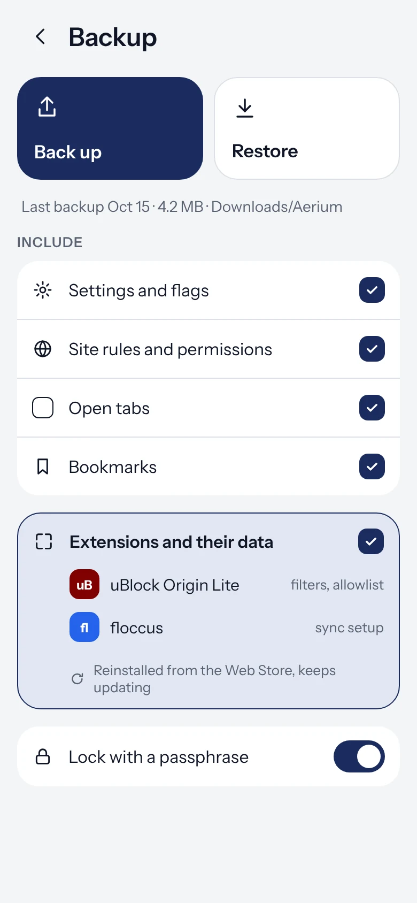

<div align="center">


# Aerium

**The Android browser that runs real Chrome extensions.**

uBlock Origin in full, Manifest V2 included, on current Chromium.

[](https://github.com/aerium-browser/aerium-browser-core/releases/latest)
[](https://github.com/aerium-browser/aerium-browser-core/releases)
[](chromium.pin)
[](https://chromiumdash.appspot.com/releases?platform=Android)
[](LICENSE)

[**Download APK**](https://github.com/aerium-browser/aerium-browser-core/releases/latest) &nbsp;&nbsp;|&nbsp;&nbsp; [Website](https://aerium-browser.github.io) &nbsp;&nbsp;|&nbsp;&nbsp; [Get it with Obtainium](https://aerium-browser.github.io/obtainium/)

<br>

&nbsp;
&nbsp;
&nbsp;


</div>

<br>

## Why Aerium

Most Android browsers can't run extensions. The few that could stopped following Chromium updates. Aerium does both.

|  | Most browsers | Older extension browsers | **Aerium** |
|---|:---:|:---:|:---:|
| Chrome Web Store extensions | ✗ | ✓ | **✓** |
| Manifest V2 (full uBlock Origin) | ✗ | ✓ | **✓** |
| Up to date Chromium | ✓ | ✗ | **✓** |
| Built straight on Chromium, no fork in between | ✓ | ✗ | **✓** |
| Aerium Guard privacy presets | ✗ | ✗ | **✓** |

## Features

**Extensions.** Install from the Chrome Web Store, Opera and Edge add-ons, or a `.crx` from GitHub. Pinned extensions sit in the toolbar and their popups fit the screen.

**Privacy.** Fingerprinting noise on canvas and layout reads, Global Privacy Control on every request, stricter site isolation, and Google's background services switched off.

**Aerogel.** Private tabs with their own window, per site rules for what gets deleted, and links from other apps can open there by default.

**Made for daily use.** True black dark mode, your own toolbar and menu, backup and restore with your extensions, an update check that never installs anything without asking.

## Install

1. Download the APK from [Releases](https://github.com/aerium-browser/aerium-browser-core/releases/latest).
2. Open the Chrome Web Store and add uBlock Origin. The store opens in its desktop layout by itself.

Prefer automatic updates? Add this repository to [Obtainium](https://aerium-browser.github.io/obtainium/).

## How it's built

This repository is the open core: Chromium plus every engine change Aerium makes.

The patches go onto Chromium's own source from `chromium.googlesource.com`, pinned in [`chromium.pin`](chromium.pin). No other browser sits in between, so a new Chromium release never waits on anyone else.

```
patches/     Chromium edits, one feature per patch
defaults/    every changed default in one table
api/         the interface the app is built on
bridge/      its engine side
build.sh     fetch, patch, compile
```

Fork it and run the **Build** workflow, it builds on GitHub runners and resumes on its own. Or run `./build.sh` on Linux.

## Support

No ads, no investors, no data sales. If Aerium is useful to you, consider a donation in [Monero](https://aerium-browser.github.io/donate/xmr) or [Litecoin](https://aerium-browser.github.io/donate/ltc). A star helps too.

## License

[GPLv3](LICENSE). Chromium keeps its BSD license. The Aerium name and logo are trademarks of Dioide, see [NOTICE](NOTICE). Security reports go through [SECURITY.md](SECURITY.md).
